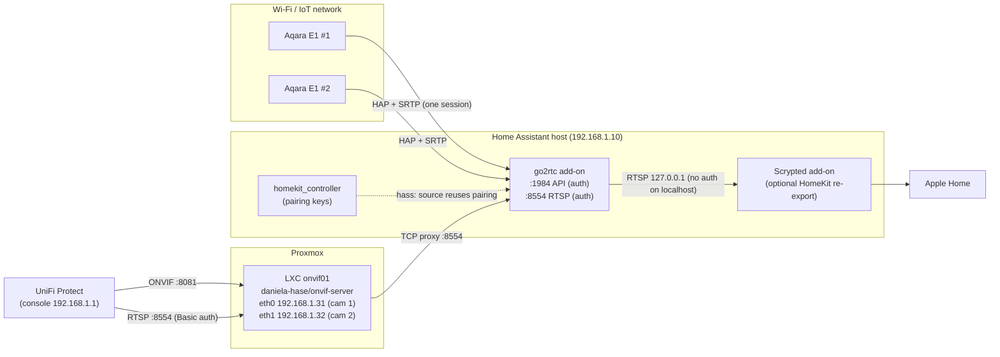

# Aqara E1 (HomeKit-only) cameras in UniFi Protect via RTSP + ONVIF

Get **HomeKit-only Aqara Camera E1** units, which have no RTSP or ONVIF of
their own, into **UniFi Protect** as third-party ONVIF cameras. Optionally keep
them in Apple Home too.

```
Aqara E1 --HomeKit (HAP/SRTP)--> Home Assistant + go2rtc --RTSP--> onvif-server (LXC) --ONVIF/RTSP--> UniFi Protect
```

Repository: <https://github.com/timohissink/aqara-e1-homekit-to-onvif-rtsp>

---

## Why this is needed

- The Aqara E1 only speaks **HomeKit Secure Video / HAP**. Without a hub it has
  no RTSP or ONVIF endpoint, so UniFi Protect cannot see it.
- [go2rtc](https://github.com/AlexxIT/go2rtc) can pull the HomeKit stream and
  re-serve it as **RTSP**. go2rtc even has a built-in ONVIF server, but Protect
  cannot adopt it:
  - go2rtc's ONVIF endpoint sits behind the API's **HTTP Basic auth**, while
    Protect only sends a **WS-UsernameToken** inside the SOAP request. Every
    ONVIF call fails with 401 (go2rtc issue #2148). You do not want to remove
    auth from the go2rtc API, because it gives full control over go2rtc.
  - All streams of one go2rtc instance share **one IP/MAC**, while Protect
    expects one camera per IP/MAC.
- [daniela-hase/onvif-server](https://github.com/daniela-hase/onvif-server)
  solves both problems:
  - It creates a small virtual ONVIF device per camera, each on its own
    MAC/IP.
  - It forwards RTSP as plain TCP to go2rtc, so go2rtc still checks the RTSP
    credentials.

## Architecture



go2rtc keeps **one** HomeKit session per camera and fans it out to all
consumers (Protect, Scrypted, the HA UI). The E1 never has to serve more than
one viewer.

## Tested with

| Component | Version |
|---|---|
| Aqara Camera E1 | HomeKit firmware, paired to Home Assistant |
| Home Assistant OS | 2026.x, `homekit_controller` integration |
| go2rtc add-on | 1.9.15 |
| daniela-hase/onvif-server | commit `7aa2c541b67b1a2760887a1706d7a5e45e5ae1a4` |
| Proxmox VE | 9.x, Debian 13 LXC template, Node.js 20.19 |
| UniFi Protect / UniFi OS | 7.3.70 / 5.1.34 (Cloud Gateway) |
| Scrypted add-on | HomeKit + RTSP Camera + Rebroadcast plugins (optional) |

## Requirements

- **Home Assistant** with the **go2rtc add-on**. The `hass:` source reads Home
  Assistant's config entries, so go2rtc must run as the add-on or have access
  to HA's `/config`.
- The E1 cameras on a network that the HA host can reach. HomeKit uses mDNS,
  so either put them in the same VLAN or use an mDNS reflector.
- A **Proxmox VE** host to run a tiny LXC. Any small Linux box works too: the
  steps are the same, only without `pct`.
- **UniFi Protect** with third-party (ONVIF) camera support.
- Optional: the **Scrypted** add-on, to keep the cameras in Apple Home.

## Step-by-step guide

```bash
git clone https://github.com/timohissink/aqara-e1-homekit-to-onvif-rtsp.git
cd aqara-e1-homekit-to-onvif-rtsp
```

### 1. Pair the E1 with Home Assistant (HomeKit Device)

1. If the E1 is in Apple Home, remove it there first. A HomeKit accessory
   accepts only one controller "owner".
2. In Home Assistant, go to **Settings > Devices & services**. The camera is
   discovered as a **HomeKit Device**. Enter the 8-digit HomeKit code from the
   camera or its box.
3. Note the **config entry title**, e.g. `Camera-E1-XXXX`. go2rtc uses it in
   step 2.

### 2. go2rtc: RTSP streams with separate credentials

Edit `/config/go2rtc.yaml` (template: [`go2rtc/go2rtc.yaml.example`](go2rtc/go2rtc.yaml.example))
and restart the add-on.

```yaml
api:
  listen: ":1984"
  username: <API_ADMIN_USER>
  password: <API_ADMIN_PASSWORD>
rtsp:
  listen: ":8554"
  username: <RTSP_USER>
  password: <RTSP_PASSWORD>
  default_query: video
streams:
  camera1:
    - hass:<E1_CONFIG_ENTRY_TITLE_1>#maxwidth=1280#maxheight=720#bitrate=1M
```

- **Separate credentials.** Use one user for the API (admin) and a different
  one for RTSP. The RTSP credentials are the ones you type into Protect.
  - Never make the API reachable without auth: the API can change the config
    and expose all streams.
  - Generate the RTSP password **without look-alike characters** (`l I 1 O 0`),
    for example:
    `tr -dc 'A-HJ-NP-Za-km-z2-9' </dev/urandom | head -c 24; echo`
- **`hass:` source.** go2rtc reuses the pairing that Home Assistant already
  has, so you do not need to pair the camera a second time.
- **`#maxwidth=1280#maxheight=720#bitrate=1M`:**
  - By default go2rtc asks the E1 for its largest resolution (1920x1080) at
    about 4 Mbit/s. On weak Wi-Fi this causes heavy **packet loss**: decode
    errors, grey smears, low fps, and Apple Home live view that stops after a
    few seconds. 720p at ~1 Mbit/s fixes this. Keep 1080p for cameras with a
    strong signal.
  - **Aspect ratio gotcha.** go2rtc does **not** scale HomeKit video. It picks
    the **largest native resolution** that fits the limits. The E1 offers
    1920x1080, 1280x720, 640x360, 480x270, 320x180 **and** 1280x960, 1024x768,
    640x480, 480x360, 320x240.
    - With only `#maxwidth=1280` you get **1280x960 (4:3)**, which looks
      stretched or square in Protect and Apple Home.
    - Always set `maxheight` too.
    - [`tools/homekit_video_attrs.py`](tools/homekit_video_attrs.py) lists what
      your camera offers, using an HA diagnostics download.

Check each stream ([`tools/stream_check.sh`](tools/stream_check.sh)):

```bash
RTSP_USER=rtspviewer RTSP_PASSWORD='...' tools/stream_check.sh 192.168.1.10 camera1 20
# expect: width=1280 height=720, SAR/DAR N/A or 1:1 / 16:9, ~0 decode errors, ~15 fps
```

### 3. Create the LXC on Proxmox

Run on the Proxmox host ([`scripts/create-lxc.sh`](scripts/create-lxc.sh)):

```bash
CTID=105 IP=192.168.1.31/24 GW=192.168.1.1 ./scripts/create-lxc.sh
```

This creates an unprivileged Debian 13 container: `nesting=1`, 1 vCPU, 512 MB
RAM, 256 MB swap, 4 GB disk, start on boot, and `firewall=1` on the NIC.

**DHCP reservation / fixed IP.** Protect identifies cameras by MAC/IP, so the
address must never change. Give the LXC a static IP outside the DHCP pool, and
also register the MAC as a fixed IP in your router (UniFi Network: client >
Settings > Fixed IP). Each virtual camera = one NIC = one MAC = one IP.

Add the CT to your backup job (PBS/vzdump). It contains the camera UUIDs; if
those change, Protect sees a new camera.

### 4. Install onvif-server (pinned commit) as a systemd service

```bash
pct push 105 scripts/install-onvif-server.sh /root/install-onvif-server.sh
pct exec 105 -- bash /root/install-onvif-server.sh
```

The script ([`scripts/install-onvif-server.sh`](scripts/install-onvif-server.sh)):

- installs Node.js, npm, git and ffmpeg;
- clones onvif-server pinned to commit `7aa2c541`;
- runs `npm install --omit=dev`;
- creates a system user `onvif`;
- installs the hardened unit [`onvif-server/onvif-server.service`](onvif-server/onvif-server.service)
  (`NoNewPrivileges`, `ProtectSystem=strict`, read-only config);
- disables ssh and postfix inside the CT (manage it with `pct enter`).

### 5. Configure the virtual camera(s)

Create `/etc/onvif-server/config.yaml` (template:
[`onvif-server/config.yaml.example`](onvif-server/config.yaml.example)):

```yaml
onvif:
  - mac: <MAC_OF_ETH0>           # pct config 105 | grep hwaddr
    name: Camera 1
    uuid: <RANDOM_UUID_V4>       # cat /proc/sys/kernel/random/uuid
    ports: { server: 8081, rtsp: 8554 }
    highQuality:
      rtsp: /camera1             # go2rtc stream name
      width: 1280                # = what go2rtc really delivers
      height: 720
      framerate: 15
      bitrate: 1024
      quality: 4
    target:
      hostname: 192.168.1.10     # go2rtc host
      ports: { rtsp: 8554 }
```

How this setup works:

- **RTSP via TCP proxy.**
  - onvif-server listens on `:8554` on the camera's own IP and pipes the TCP
    connection unchanged to go2rtc `:8554`.
  - Protect's `RTSP Basic auth` therefore reaches go2rtc, which validates it.
  - onvif-server itself does **not** validate the ONVIF login, which is why the
    firewall in step 6 matters.
- **Use RTSP over TCP.** The proxy only forwards the TCP control connection,
  not UDP. Protect uses interleaved TCP, so this works.
- **No snapshot URL is configured on purpose.** A snapshot proxy would need the
  go2rtc API on the LAN. Protect shows a placeholder image in a few places;
  live view and recording work normally.
- **Keep the resolution in sync.** Make `width`/`height`/`bitrate` match the
  real stream, so Protect does not get confused.

```bash
systemctl enable --now onvif-server
journalctl -u onvif-server -f
```

More than one camera: see [`docs/multiple-cameras.md`](docs/multiple-cameras.md)
(an extra NIC per camera, plus ARP settings).

### 6. Proxmox firewall: only Protect may connect

Templates are in [`proxmox/firewall/`](proxmox/firewall/).

- Proxmox evaluates guest firewalls **only if the datacenter firewall is
  enabled**. To enable it without affecting anything else:
  - `cluster.fw`: `enable: 1`, `policy_in: ACCEPT`, `policy_out: ACCEPT`.
    Merge this with an existing file; do not overwrite it.
  - `host.fw`: `enable: 0`, so the host firewall stays off for SSH, port 8006
    and storage.
  - `<CTID>.fw`: `policy_in: DROP`, and only allow the Protect console IP on
    tcp 8081, tcp 8554 and udp 3702.

Check afterwards that the Proxmox UI, SSH and your other guests are still
reachable.

Test from a host you have temporarily allowed in the firewall:

```bash
tools/onvif_test.sh 192.168.1.31            # Manufacturer Onvif, profile main_stream 1280x720, stream URI
RTSP_USER=rtspviewer RTSP_PASSWORD='...' tools/rtsp_test.py 192.168.1.31 /camera1
# without login -> 401, with login -> 200 OK + H264
```

### 7. Adopt in UniFi Protect

1. In Protect, enable **third-party camera discovery** (Settings > System /
   Devices, "Discover third-party cameras", depending on your version).
2. The virtual camera appears as **"Onvif Cardinal"** with the IP of the LXC
   NIC. Click **Adopt**.
3. Username and password: enter the **go2rtc RTSP credentials**
   (`<RTSP_USER>` / `<RTSP_PASSWORD>`), **not** the API admin. Copy and paste
   the password if possible.
4. Rename the camera. Live view should start within a few seconds.

Verify on the go2rtc side: `GET /api/streams` (with the API login) should list
consumers from the LXC IP with user agent `Media Server (www.ui.com)` and a
non-zero byte count.

### 8. Optional: keep the cameras in Apple Home

See [`docs/scrypted-homekit.md`](docs/scrypted-homekit.md). Scrypted re-exports
`rtsp://127.0.0.1:8554/<stream>` as standalone HomeKit cameras.

## Troubleshooting

| Symptom | Cause | Fix |
|---|---|---|
| Adopted in Protect, but **black picture, 0 bps** | Protect's RTSP `OPTIONS`/`DESCRIBE` gets **401**. The password typed in Protect differs from go2rtc's, often by one look-alike character (`l`/`I`/`1`, `O`/`0`). | Check with `tools/rtsp_test.py` or `tcpdump -A port 8554` on the CT (look for `401`). Re-enter the password or set a password without ambiguous characters. Then switch the camera off and on in Protect. |
| Picture looks **stretched / squarish** | go2rtc chose a native **4:3** mode (1280x960) because only `maxwidth` was set. | Add `#maxheight=720`; check with `tools/stream_check.sh` (expect 1280x720). Update `width`/`height` in onvif-server. |
| Grey smears, low fps, Apple Home stops after a few seconds; Scrypted logs `packet loss` / `fua packet missing` | 1080p at ~4 Mbit/s over weak Wi-Fi to the E1 | `#maxwidth=1280#maxheight=720#bitrate=1M`; improve Wi-Fi or AP placement |
| **Protect black / frozen** after a go2rtc restart or config change | Protect does not always reconnect cleanly | Switch the camera **off and on** in Protect (or reboot it from Protect) |
| Apple Home live view not loading after go2rtc changes | Scrypted prebuffer reconnecting | Wait ~30 s, then close and reopen the Home app |
| All virtual cameras show the **same stream** / Protect sees one device | Several IPs answered with the same MAC (ARP flux), or the same `uuid` | One NIC per camera, `arp_ignore=1` / `arp_announce=2`, unique UUIDs; see [`docs/multiple-cameras.md`](docs/multiple-cameras.md) |
| Camera not discovered | Firewall blocks WS-Discovery, or the CT is in another VLAN than Protect | Allow udp 3702 from the console; same L2 network or add it manually by IP |
| `Wsse authorized time check failed` | Clock skew | Make sure the Proxmox host (and so the CT) has NTP |
| go2rtc stream exists, but no producer starts | The E1 is unreachable via mDNS/HAP, or the camera was re-paired | Check the HomeKit Device in HA; it must be online |

## Security notes

- The **go2rtc API (:1984) must always require auth**. Never publish it, and
  never use its credentials in Protect.
- Use a **dedicated RTSP user** for Protect. go2rtc accepts unauthenticated
  RTSP only from localhost (e.g. Scrypted on the same host).
- onvif-server does **not** check ONVIF credentials. Restrict the LXC with a
  firewall to the Protect console only.
- No snapshot proxy, so the go2rtc API is never exposed via the LXC.
- Keep configs with real credentials out of git (see `.gitignore`).
- **HomeKit pairing keys** are stored in Home Assistant's `.storage` and appear
  in go2rtc's `/api/streams` output (as the producer `source`). Treat that
  output, and HA backups, as secrets.
- Pin onvif-server to a reviewed commit; update deliberately.

## Repository layout

```
.
├── README.md
├── LICENSE
├── go2rtc/go2rtc.yaml.example            # go2rtc add-on config
├── onvif-server/config.yaml.example      # 3 virtual cameras
├── onvif-server/onvif-server.service     # hardened systemd unit
├── proxmox/firewall/*.fw.example         # cluster / host / CT firewall
├── scripts/create-lxc.sh                 # Proxmox: create Debian 13 LXC
├── scripts/install-onvif-server.sh       # inside LXC: install + service
├── scripts/add-camera-nic.sh             # Proxmox: extra NIC per camera
├── tools/stream_check.sh                 # ffprobe/ffmpeg: resolution, SAR/DAR, errors
├── tools/rtsp_test.py                    # RTSP DESCRIBE with/without auth
├── tools/onvif_test.sh                   # ONVIF device/profile/stream URI
├── tools/homekit_video_attrs.py          # list native E1 resolutions
└── docs/
    ├── multiple-cameras.md
    └── scrypted-homekit.md
```

## Credits

- [AlexxIT/go2rtc](https://github.com/AlexxIT/go2rtc): HomeKit client, the
  `hass:` source and the RTSP server.
- [daniela-hase/onvif-server](https://github.com/daniela-hase/onvif-server):
  virtual ONVIF devices for UniFi Protect (MIT).
- [Home Assistant `homekit_controller`](https://www.home-assistant.io/integrations/homekit_controller/).
- [Scrypted](https://github.com/koush/scrypted): HomeKit re-export.
- [Proxmox VE](https://www.proxmox.com/) and Ubiquiti
  [UniFi Protect](https://ui.com/camera-security).

Not affiliated with Aqara, Apple, Ubiquiti or any of the projects above.

## License

MIT © 2026 Timo Hissink. See [LICENSE](LICENSE).
